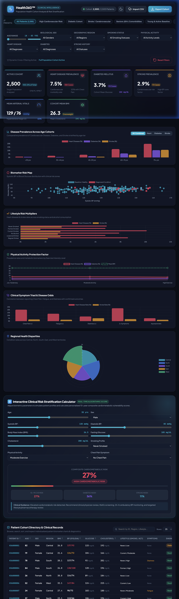

# Health360™ | Clinical Intelligence & Population Health Analytics

An interactive clinical intelligence and population health dashboard built for analyzing cardiometabolic diseases, risk stratification, and patient-level biomarker correlations using the `Health360` healthcare dataset (2,500 patient cohort).



---

## 🌟 Key Features

1. **Executive Clinical KPI Metrics**:
   - **Active Cohort Size & Gender Split**: Dynamic patient count & percentage of total cohort.
   - **Heart Disease Prevalence**: Total diagnoses and angina/chest-pain correlation.
   - **Diabetes Mellitus**: Cohort prevalence and mean fasting glucose (mg/dL).
   - **Stroke Prevalence**: Cerebrovascular event rates and high-risk factor tracking.
   - **Mean Arterial Vitals**: Cohort mean Systolic/Diastolic BP with Stage 1 & 2 Hypertension percentage.
   - **Mean BMI & Lipid Profile**: Cohort average BMI classification and total cholesterol.

2. **Interactive Visualizations (Chart.js)**:
   - **Disease Prevalence Across Age Cohorts**: Grouped/segmented bar chart comparing Heart Disease, Diabetes, and Stroke rates across age brackets (`<30`, `30-44`, `45-59`, `60-74`, `75+`), togglable by gender.
   - **Biomarker Risk Scatter Map**: Interactive scatter visualization plotting Systolic Blood Pressure vs. Blood Glucose with patient-level hover cards and clinical risk threshold zones.
   - **Lifestyle Risk Multipliers**: Horizontal bar chart comparing morbidity outcomes across Smoking status (*Never, Former, Current*) and Alcohol consumption (*None, Occasional, Regular*).
   - **Physical Activity Protection Factor**: Multi-metric trend analysis showing how exercise intensity (*Low, Moderate, High*) reduces chronic disease rates and lowers BMI.
   - **Clinical Symptom Triad Odds**: Correlation matrix between reporting Chest Pain, Fatigue, and Dizziness with confirmed outcomes.
   - **Regional Health Equity**: Polar area breakdown of chronic morbidity across Central, North, South, East, and West territories.

3. **Interactive Clinical Risk Stratification Calculator**:
   - Real-time what-if simulator using validated Framingham and ADA risk factor models.
   - Sliders for Age, Systolic/Diastolic BP, BMI, Fasting Glucose, Cholesterol, Smoking, Activity, and Chest Pain.
   - Instant calculation of **10-Year Cardiovascular Risk**, **Diabetes Index**, **Stroke Probability**, and **Composite Risk Tier** with tailored clinical guidance.

4. **Patient Cohort Directory & Clinical Records Explorer**:
   - Searchable, sortable, and paginated patient table with row-level biomarker badges.
   - Interactive **Patient Detail Modal** with full vitals and a 6-axis **Biometric Radar Chart** comparing the individual patient against the population cohort average.

5. **Cohort Presets & Export/Import**:
   - Quick one-click cohort filters: *All Patients*, *High Cardiovascular Risk*, *Diabetic Cohort*, *Stroke Risk*, *Seniors (65+) Comorbidities*, *Young & Active Baseline*, *Smokers with Hypertension*.
   - **Export Cohort**: Download filtered cohort directly to CSV.
   - **Import CSV**: Drag-and-drop or upload new CSV datasets to re-compute all statistics live.
   - **Dark / Light Theme Switcher**: Obsidian Slate dark theme default with crisp light mode.

---

## 🚀 How to Run

### Method 1: Instant Browser Launch (No server required)
Open [`index.html`](file:///Users/abhinavkumar/.gemini/antigravity-ide/scratch/health360_dashboard/index.html) directly in any browser:
```bash
open /Users/abhinavkumar/.gemini/antigravity-ide/scratch/health360_dashboard/index.html
```

### Method 2: Local Web Server
Run the included launcher script:
```bash
./run_dashboard.sh
```
Or with Python:
```bash
python3 -m http.server 3000 --directory /Users/abhinavkumar/.gemini/antigravity-ide/scratch/health360_dashboard
```
Then navigate to: `http://localhost:3000`

---

## 📁 File Structure

```
health360_dashboard/
├── index.html            # Main semantic HTML5 structure & UI layout
├── style.css             # Obsidian medical dark/light CSS design system
├── app.js                # Application state, Chart.js engine & risk algorithms
├── data.js               # Pre-compiled 2,500 patient cohort for instant loading
├── dataset.csv           # Original Health360 CSV dataset
├── prepare_data.py       # Data extraction and pre-processing pipeline
├── run_dashboard.sh      # Executable launch script
└── README.md             # Documentation and usage guide
```
